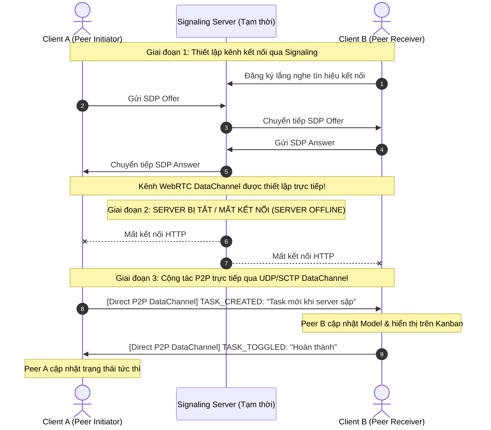

# BÁO CÁO PHÂN TÍCH VÀ TIẾN HÓA KIẾN TRÚC PHẦN MỀM
## Đề tài: Tiến Hóa Kiến Trúc Ứng Dụng Quản Lý Công Việc (V1 → V4)
**Học phần:** Nhập môn Công nghệ Phần mềm (SE)  
**Vai trò:** Kỹ sư Công nghệ Phần mềm / Kiến trúc sư Phần mềm (Senior Software Architect)  
**Tiêu chuẩn áp dụng:** Clean Architecture, Domain-Driven Design (DDD), Separation of Concerns, Modifiability & Availability Tactics.

---

## I. TỔNG QUAN VÀ CHIẾN LƯỢC TIẾN HÓA MÃ NGUỒN

Ứng dụng quản lý công việc được phát triển xuyên suốt từ **V1 đến V4 trên cùng một codebase duy nhất**, không viết lại ứng dụng mới. Phạm vi nghiệp vụ cốt lõi được giữ bất biến qua các phiên bản:
1. Tạo công việc có tên.
2. Xem danh sách công việc.
3. Cập nhật trạng thái (Chưa hoàn thành ↔ Hoàn thành).
4. Xóa công việc.

Tuy nhiên, các **Thuộc tính chất lượng (Non-Functional Requirements - NFR)** và **Môi trường vận hành** thay đổi sâu sắc qua từng giai đoạn, thúc đẩy sự tiến hóa kiến trúc:
- **V1 (Local Monolith)**: Khả năng lưu trữ bền vững trên một máy cá nhân.
- **V2 (Client–Server)**: Chia sẻ trạng thái tập trung giữa nhiều thiết bị/client đồng thời.
- **V3 (N-Layer & MVC/MVVM)**: Tính dễ sửa đổi (Modifiability) — thay thế giao diện người dùng và cơ chế lưu trữ mà không ảnh hưởng tầng nghiệp vụ.
- **V4 (Peer-to-Peer / WebRTC Mesh)**: Tính sẵn sàng cao (High Availability) — cộng tác trực tiếp khi server trung tâm gặp sự cố/ngắt kết nối.

---

## II. PHÂN TÍCH RÀNG BUỘC VÀ GIỚI HẠN KIẾN TRÚC QUA TỪNG PHIÊN BẢN

Theo quy tắc kỹ thuật phần mềm, trước khi bước vào mỗi phiên bản, kiến trúc sư xác định rõ: **1 câu về ràng buộc mới** và **1 câu về điểm hạn chế của thiết kế hiện tại**.

### 1. Phiên bản V1: Ứng dụng ban đầu (Chạy cục bộ trên 1 máy)
- **Ràng buộc mới:** Dữ liệu phải được lưu trữ bền vững (Persistence) trên ổ đĩa cục bộ để không bị mất khi ứng dụng khởi động lại.
- **Hạn chế của thiết kế hiện tại:** Ứng dụng gắn chặt với môi trường chạy đơn lẻ trên một máy; không hỗ trợ chia sẻ dữ liệu hoặc truy cập đồng thời từ thiết bị khác.
- **Chiêm nghiệm kỹ sư:** Thiết kế V1 chỉ phù hợp cho người dùng cá nhân (Single-user Desktop/Local Tool).

### 2. Phiên bản V2: Hai người cùng sử dụng (Client–Server)
- **Ràng buộc mới:** Nhiều client trên các trình duyệt/thiết bị khác nhau phải quan sát và đồng bộ được các thay đổi công việc từ người khác theo thời gian thực hoặc gần thời gian thực.
- **Hạn chế của thiết kế hiện tại:** Cơ chế lưu file cục bộ không hỗ trợ đồng bộ mạng; nếu nhiều người cùng truy cập trực tiếp file JSON trên ổ đĩa sẽ gây tranh chấp tài nguyên (File Lock / Race Conditions) và thiếu điểm quản lý trạng thái tập trung.
- **Chiêm nghiệm kỹ sư:** Cần chuyển đổi sang mô hình Client–Server, đặt backend làm Single Source of Truth và triển khai cơ chế Polling đồng bộ trạng thái.

### 3. Phiên bản V3: Thay giao diện (Kanban) và Nguồn lưu trữ (SQLite)
- **Ràng buộc mới:** Giao diện phải chuyển từ dạng danh sách sang bảng Kanban 2 cột, cơ sở dữ liệu chuyển từ file JSON sang SQLite quan hệ nhưng phải đảm bảo không làm mất dữ liệu cũ và hành vi nghiệp vụ giữ nguyên.
- **Hạn chế của thiết kế hiện tại:** Mã nguồn V1/V2 có xu hướng kết dính giữa định dạng dữ liệu (JSON) và cách hiển thị giao diện; nếu không phân tách các tầng kiến trúc (N-Layer / MVC), việc thay đổi cơ sở dữ liệu và giao diện sẽ dẫn đến sửa đổi tràn lan và rủi ro lỗi cao.
- **Chiêm nghiệm kỹ sư:** Áp dụng Clean Architecture: tách biệt ranh giới Presentation, Business Logic (TaskService) và Data Access (Repository Pattern + Strategy Pattern) kèm dịch vụ Data Migration an toàn.

### 4. Phiên bản V4: Cộng tác khi mất kết nối Server (P2P Collaboration)
- **Ràng buộc mới:** Hai thiết bị trong mạng phải tiếp tục tạo task và đổi trạng thái trực tiếp với nhau ngay cả khi server trung tâm bị sập/mất kết nối hoàn toàn.
- **Hạn chế của thiết kế hiện tại:** Mô hình Client–Server tập trung có điểm lỗi đơn (Single Point of Failure - SPOF); khi server offline, toàn bộ client bị tê liệt không thể tương tác hay gửi cập nhật cho nhau.
- **Chiêm nghiệm kỹ sư:** Thiết lập kênh truyền ngang hàng trực tiếp (WebRTC DataChannel) giữa các peer để truyền tải thay đổi mà không cần server trung gian.

---

## III. BẢNG NHẬT KÝ QUYẾT ĐỊNH KIẾN TRÚC VÀ KIỂM CHỨNG (MỤC 04)

| Version | NFR Mới (Thuộc tính chất lượng) | Quyết định thiết kế kiến trúc | File / Thành phần thay đổi | Kết quả kiểm chứng (Test Results) |
| :--- | :--- | :--- | :--- | :--- |
| **V1** | **Persistence** (Độ bền vững dữ liệu cục bộ) | Sử dụng `JsonTaskRepository` ghi file atomic vào `data/tasks.json`. Giao diện đơn giản hiển thị danh sách dạng vertical list. | - `src/domain/Task.js`<br>- `src/repositories/JsonTaskRepository.js`<br>- `public/js/ListView.js` | **ĐẠT (PASS)**: Tạo 2 task, đánh dấu hoàn thành 1 task. Tắt server, khởi động lại: dữ liệu 2 task và trạng thái được khôi phục 100%. |
| **V2** | **Centralized State Sharing & Multi-tenancy** (Chia sẻ trạng thái tập trung giữa nhiều client) | Thiết kế REST API tập trung (`server.js`). Client sử dụng `ApiStorage` với cơ chế **Polling định kỳ (2.5s)** để định kỳ lấy trạng thái mới nhất từ server. | - `src/controllers/TaskController.js`<br>- `server.js`<br>- `public/js/ApiStorage.js` | **ĐẠT (PASS)**: Mở 2 trình duyệt riêng biệt A và B. Client A tạo task, Client B thấy sau ~2.5s mà không cần F5; Client B đánh dấu hoàn thành, Client A cập nhật tức thì. |
| **V3** | **Modifiability & Maintainability** (Dễ bảo trì và thay thế thành phần) | Tách kiến trúc theo **N-Layer & MVC/MVVM**. Thay giao diện bằng `KanbanView` (2 cột). Triển khai `SqliteTaskRepository` với SQLite và lớp `DataMigration` di chuyển tự động từ JSON sang DB. | - `src/repositories/SqliteTaskRepository.js`<br>- `src/repositories/DataMigration.js`<br>- `public/js/KanbanView.js`<br>- `public/css/app.css` | **ĐẠT (PASS)**: Toàn bộ task cũ từ file JSON được chuyển nguyên vẹn sang SQLite. Bảng Kanban hoạt động mượt mà, chuyển trạng thái 2 cột chuẩn xác. Tầng `TaskService` giữ nguyên không sửa 1 dòng logic. |
| **V3.5** | **Multi-Tenancy & User Context** (Đa người dùng & Phân công công việc) | Bổ sung ngữ cảnh người dùng (`assignee`, `creator`). Hỗ trợ chọn danh tính giả lập (Alice, Bob, Charlie) và bộ lọc công việc cá nhân. Nâng cấp schema SQLite với cột `assignee`. | - `src/domain/Task.js`<br>- `src/repositories/SqliteTaskRepository.js`<br>- `public/js/app.js`<br>- `public/index.html` | **ĐẠT (PASS)**: Tạo task gán cho Alice và Bob; Thẻ Kanban hiển thị badge `👤 Alice`, `👤 Bob`; Chuyển bộ lọc sang "Chỉ của tôi" lọc chính xác công việc của từng cá nhân. |
| **V4** | **High Availability & Fault Tolerance** (Sẵn sàng cao khi mất server trung tâm) | Bổ sung kiến trúc lai (Hybrid Client-Server + Peer-to-Peer). Sử dụng **WebRTC DataChannel** để thiết lập kênh truyền dữ liệu trực tiếp giữa 2 trình duyệt peer. | - `public/js/P2PPeerManager.js`<br>- `public/js/app.js`<br>- `public/index.html` (P2P Panel) | **ĐẠT (PASS)**: Thiết lập kết nối P2P giữa Tab A và Tab B. **TẮT HOÀN TOÀN SERVER BACKEND** (Server Offline). Tab A tạo task mới &rarr; Tab B nhận ngay lập tức qua P2P; Tab B đổi trạng thái &rarr; Tab A nhận phản hồi trực tiếp. |

---

## IV. SƠ ĐỒ KIẾN TRÚC QUA CÁC PHIÊN BẢN (MERMAID DIAGRAMS)

### 1. Sơ đồ Kiến trúc V2 (Client–Server tập trung)
Mô hình Client-Server quản lý trạng thái tập trung với cơ chế Polling:

```mermaid
graph TD
    subgraph Client_Tier ["Tầng Client (Trình duyệt đa người dùng)"]
        CA["Client A (Browser Tab 1)"]
        CB["Client B (Browser Tab 2)"]
    end

    subgraph Server_Tier ["Tầng Backend Server (Single Source of Truth)"]
        HTTP["HTTP REST API Router"]
        CTRL["Task Controller"]
        SERV["Task Service (Business Rules)"]
    end

    subgraph Storage_Tier ["Tầng Lưu trữ"]
        JSON[("File tasks.json\n(Atomic File Lock)")]
    end

    CA -->|1. POST /api/tasks (Tạo task)| HTTP
    CA -.->|2. Polling định kỳ GET /api/tasks| HTTP
    CB -.->|3. Polling định kỳ GET /api/tasks| HTTP
    CB -->|4. POST /api/tasks/:id/toggle| HTTP

    HTTP --> CTRL
    CTRL --> SERV
    SERV --> JSON
```

---

### 2. Sơ đồ Kiến trúc V3 (N-Layer & Clean Architecture / MVC)
Minh họa sự phân tách ranh giới rõ ràng: Tầng Presentation (Kanban View), Tầng Nghiệp vụ (TaskService), Tầng Dữ liệu (Repository Pattern trừu tượng hóa JSON và SQLite) cùng dịch vụ Migration:

```mermaid
graph TD
    subgraph Presentation_Layer ["Presentation Layer (Giao diện & Điều khiển)"]
        UI_Old["ListView (Danh sách cũ - V1/V2)"]
        UI_New["KanbanView (Kanban 2 cột - V3)"]
        AppCtrl["AppController (Client MVC Coordinator)"]
        HTTPCtrl["TaskController (Backend REST Adapter)"]
    end

    subgraph Application_Layer ["Application & Business Logic Layer"]
        TaskSvc["TaskService (Quản lý nghiệp vụ công việc)"]
        TaskEntity["Domain Entity: Task\n(Invariants & State Transition)"]
    end

    subgraph Persistence_Layer ["Data Access & Persistence Layer (Repository Pattern)"]
        ITaskRepo["<< Interface >>\nITaskRepository"]
        JsonRepo["JsonTaskRepository\n(Đọc/Ghi tasks.json)"]
        SqliteRepo["SqliteTaskRepository\n(Đọc/Ghi tasks.db)"]
        MigrateSvc["DataMigration Service\n(tasks.json -> tasks.db)"]
    end

    UI_Old -.->|Hiển thị| AppCtrl
    UI_New -->|Hiển thị| AppCtrl
    AppCtrl -->|HTTP REST| HTTPCtrl
    HTTPCtrl --> TaskSvc
    TaskSvc --> TaskEntity

    TaskSvc -->|Phụ thuộc vào trừu tượng| ITaskRepo
    ITaskRepo <|.. JsonRepo
    ITaskRepo <|.. SqliteRepo
    MigrateSvc -->|Đọc| JsonRepo
    MigrateSvc -->|Ghi an toàn| SqliteRepo
```

---

### 3. Sơ đồ Luồng Kết Nối V4 (P2P WebRTC DataChannel khi mất Server)
Minh họa quá trình thiết lập kênh ngang hàng và truyền tải trực tiếp sau khi tắt Server:



---

## V. TRẢ LỜI CHI TIẾT 4 CÂU HỎI THẢO LUẬN (MỤC 05)

### ❓ Câu 1: Nếu V1 đã có backend, việc nâng cấp V2 thay đổi điều gì về cách sử dụng hoặc triển khai, thay vì chỉ đổi tên kiến trúc?
**Trả lời của Kỹ sư Công nghệ Phần mềm:**
1. **Về mặt Triển khai (Deployment):**
   - Ở V1, backend chỉ phục vụ cục bộ trên giao diện loopback (`127.0.0.1` hoặc quy trình nội bộ), không cần cấu hình CORS, bind IP công khai hoặc quản lý hạ tầng mạng.
   - Ở V2, backend phải được triển khai như một **Dịch vụ mạng thực sự**: cấu hình bind IP mở (`0.0.0.0` hoặc IP mạng LAN), mở port firewall, cấu hình CORS headers (`Access-Control-Allow-Origin: *`) để cho phép các client từ các origin/thiết bị khác nhau kết nối.
2. **Về mặt Cách sử dụng & Quản lý trạng thái (State Synchronization):**
   - V1 là **mô hình độc quyền (Single-tenancy)**: client sở hữu toàn quyền vòng đời dữ liệu, không có khái niệm "dữ liệu bị thay đổi bởi người khác".
   - V2 là **mô hình đồng thời (Concurrency & Multi-client)**: client không còn là nguồn chân lý duy nhất. Client phải định kỳ truy vấn (Polling) hoặc nhận thông báo (Push/SSE) để đồng bộ trạng thái mới nhất từ server.
3. **Về mặt Toàn vẹn dữ liệu (Data Integrity):**
   - V2 đòi hỏi cơ chế backend xử lý tranh chấp ghi (Race conditions). Nếu hai client cùng gửi yêu cầu sửa đổi, backend phải đóng vai trò serialize hoặc lock để không làm hỏng file `tasks.json`.

---

### ❓ Câu 2: Ở V3, phần nào thay đổi khi thiết kế lại UI, phần nào thay đổi khi chuyển JSON sang SQLite? Có bằng chứng tách biệt không?
**Trả lời của Kỹ sư Công nghệ Phần mềm:**
1. **Khi thiết kế lại UI (Danh sách &rarr; Kanban 2 cột):**
   - **Thành phần thay đổi:** Chỉ duy nhất tầng **Presentation Layer** (`public/js/KanbanView.js`, `public/css/app.css` và `public/index.html`).
   - **Thành phần KHÔNG bị ảnh hưởng:** Tầng Domain Model (`Task.js`), tầng Business Logic (`TaskService.js`), tầng Data Access (`ITaskRepository`, `JsonTaskRepository`, `SqliteTaskRepository`) và REST API endpoints (`/api/tasks`) hoàn toàn không thay đổi một dòng code nào.
2. **Khi chuyển JSON sang SQLite:**
   - **Thành phần thay đổi:** Chỉ duy nhất tầng **Data Access Layer** &mdash; bổ sung `SqliteTaskRepository.js` và `DataMigration.js`. Trong `TaskController.js`, chỉ cần trỏ tham chiếu repository sang đối tượng mới thông qua Dependency Injection.
   - **Thành phần KHÔNG bị ảnh hưởng:** Giao diện Kanban không cần biết dữ liệu được lưu trong file JSON hay bảng cơ sở dữ liệu quan hệ SQLite; API contract (`id`, `title`, `completed`, `createdAt`, `updatedAt`) giữ nguyên 100%.
3. **Bằng chứng tách biệt (Proof of Separation of Concerns):**
   - Minh chứng cụ thể trong mã nguồn: Lớp `TaskService` nhận bất kỳ đối tượng nào hiện thực `ITaskRepository` thông qua hàm `setRepository(repo)`. Ta có thể bấm nút "Dùng JSON" hoặc "Dùng SQLite" ngay trên thanh điều khiển của ứng dụng mà nghiệp vụ thêm/xóa/đổi trạng thái công việc vẫn hoạt động trơn tru không hề gián đoạn.

---

### ❓ Câu 3: V4 cải thiện tính sẵn sàng trong tình huống nào? Đổi lại, hệ thống mất những bảo đảm gì về đồng bộ và nhất quán?
**Trả lời của Kỹ sư Công nghệ Phần mềm:**
1. **Tình huống V4 cải thiện tính sẵn sàng (Availability):**
   - V4 phát huy hiệu quả tối đa khi **Server trung tâm gặp sự cố bất ngờ** (sập nguồn, lỗi phần mềm, quá tải) hoặc **Môi trường làm việc bị cắt đứt kết nối Internet/WAN ra ngoài**, nhưng các thiết bị của người dùng vẫn nằm trong cùng một mạng LAN / Wi-Fi nội bộ. Trong bối cảnh này, kiến trúc Client-Server truyền thống sẽ tê liệt hoàn toàn, trong khi kênh WebRTC P2P cho phép người dùng tiếp tục công việc cộng tác nhóm mà không bị gián đoạn.
2. **Các bảo đảm bị mất đi theo định lý CAP / PACELC:**
   - **Mất tính nhất quán mạnh (Strong Consistency & Linearizability):** Không còn một "Single Source of Truth" duy nhất đóng vai trò trọng tài để quyết định thứ tự tuyệt đối của các sự kiện ghi.
   - **Mất bảo đảm giải quyết tranh chấp (Conflict Resolution):** Nếu cả Peer A và Peer B cùng chỉnh sửa tiêu đề hoặc cùng chuyển trạng thái một task tại cùng một thời điểm microsecond khi đang mất kết nối, hệ thống sẽ rơi vào trạng thái xung đột dữ liệu (Split-brain).
   - **Mất tính bền vững tập trung (Centralized Durability):** Dữ liệu mới tạo trong phiên P2P chỉ tồn tại trong bộ nhớ RAM/Local storage của hai peer. Nếu cả hai người cùng tắt trình duyệt trước khi server trung tâm phục hồi để hòa giải dữ liệu, các task đó có nguy cơ thất thoát.

---

### ❓ Câu 4: Trong trường hợp nào một server LAN đơn giản có thể hợp lý hơn P2P?
**Trả lời của Kỹ sư Công nghệ Phần mềm:**
Một mô hình Server LAN cục bộ (ví dụ: máy tính của nhóm trưởng đóng vai trò server hoặc một chiếc Raspberry Pi / mini PC cắm mạng LAN) sẽ **hợp lý và tối ưu hơn P2P** trong các trường hợp sau:
1. **Số lượng thành viên lớn (> 5-10 người):** Kiến trúc P2P dạng Full Mesh đòi hỏi mỗi peer phải duy trì `N * (N - 1) / 2` kết nối WebRTC DataChannel. Khi nhóm có 10 người, số kết nối tăng lên 45; khi có 20 người là 190 kết nối, gây quá tải băng thông và CPU của thiết bị cá nhân. Một server LAN chỉ cần `N` kết nối hình sao (Star Topology).
2. **Yêu cầu bảo mật và quyền sở hữu dữ liệu tập trung (Audit & Compliance):** Khi doanh nghiệp yêu cầu nhật ký chỉnh sửa phải được kiểm soát, sao lưu định kỳ tự động và phân quyền nghiêm ngặt, Server LAN dễ quản lý hơn nhiều so với việc phân tán dữ liệu rải rác trên máy trạm của nhân viên.
3. **Thiết bị thành viên thường xuyên ngắt kết nối (Churn Rate cao):** Nếu hai người dùng A và B tắt máy, các thành viên khác trong P2P có thể mất quyền truy cập vào các task do A hoặc B khởi tạo nếu chưa kịp gossip. Một Server LAN luôn bật giải quyết triệt để bài toán này.
4. **Độ phức tạp kỹ thuật (KISS Principle):** Thiết lập một HTTP server hoặc WebSocket server nội bộ trong mạng LAN đơn giản, ổn định và không phụ thuộc vào các giao thức đàm phán ICE/STUN/SDP phức tạp của WebRTC.

---

## VI. PHÂN TÍCH ĐÁNH ĐỔI KỸ THUẬT VÀ CƠ CHẾ GIẢI QUYẾT XUNG ĐỘT (CONFLICT RESOLUTION)

Khi chuyển từ kiến trúc tập trung sang phân tán (V3 sang V4), bài toán dung hòa dữ liệu trở thành trọng tâm:
1. **Cơ chế Last-Write-Wins (LWW) dựa trên Timestamp:**
   - Mỗi task mang trường `updatedAt` chuẩn ISO-8601 UTC. Khi nhận gói tin P2P cho cùng một task, client so sánh timestamp: bản ghi có thời gian mới hơn sẽ ghi đè bản ghi cũ.
   - *Nhược điểm:* Phụ thuộc vào đồng hồ hệ thống (Clock Drift) giữa hai máy.
2. **Cơ chế Vector Clocks / Lamport Timestamps:**
   - Đánh dấu phiên bản bằng bộ đếm logic `[PeerA: 2, PeerB: 1]` để phát hiện xung đột song song (Concurrent edits) và cảnh báo cho người dùng chủ động chọn phiên bản giữ lại.
3. **Cơ chế CRDTs (Conflict-free Replicated Data Types):**
   - Hướng tiếp cận cao cấp cho tương lai: sử dụng **LWW-Element-Set** hoặc **State-based CRDTs** giúp các peer tự động hợp nhất trạng thái mà không cần trọng tài trung tâm.

---

## VII. KẾT LUẬN

Bài tập thực hành đã chứng minh trực quan lộ trình **tiến hóa kiến trúc phần mềm**:
- Không có một kiến trúc nào là "hoàn hảo cho mọi bài toán" &mdash; kiến trúc là tập hợp các **quyết định đánh đổi (Trade-offs)** nhằm thỏa mãn tập thuộc tính chất lượng (NFR) tại từng thời điểm.
- Việc áp dụng **Clean Architecture** ngay từ đầu (tách Domain, Service, Repository) là yếu tố quyết định giúp codebase dễ dàng thay đổi UI (sang Kanban) và thay đổi Database (sang SQLite) ở V3 mà không gây đổ vỡ hệ thống.
- Chế độ P2P ở V4 khẳng định tư duy phòng thủ trong thiết kế phần mềm hiện đại: luôn chuẩn bị giải pháp dự phòng khi cơ sở hạ tầng trung tâm gặp sự cố.
